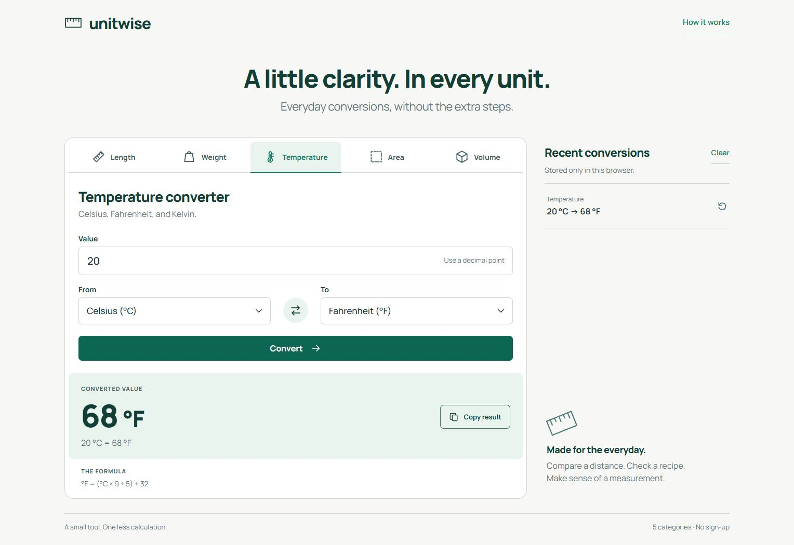

# Unitwise — Unit Converter

[](https://github.com/batuhansacofficial/UnitConverter/actions/workflows/ci.yml)
[](docs/verification.md#measured-coverage)

Convert **length, weight, temperature, area and volume** through a responsive web interface or JSON API. Unitwise combines a shared C# conversion engine with inline validation, formula explanations and browser-local history.

**[Live demo](https://unitwise.onrender.com)** · **[Swagger UI](https://unitwise.onrender.com/swagger)** · **[Architecture](docs/architecture.md)** · **[Postman collection](docs/unitwise.postman_collection.json)** · **[Verification](docs/verification.md)**

| At a glance | Implementation |
| --- | --- |
| Stack | .NET 10 · ASP.NET Core Razor Pages + Minimal APIs · HTML/CSS/JavaScript |
| Architecture | Web form and JSON endpoints call one stateless conversion service; one Docker container, no database or external conversion API |
| Beyond the [project brief](https://roadmap.sh/projects/unit-converter) | Documented JSON API and Swagger UI; swap/copy; restore the last five conversions; formulas and rounding indicators |
| Evidence | **85 passing tests** (57 domain, 28 HTTP); **95.5% application line coverage** snapshot; CI builds, tests and smoke-checks the non-root runtime image; Render automatically deploys `main` after checks pass |

The CI badge shows current workflow status. Coverage is a measured C#/Razor/API snapshot; JavaScript and CSS are excluded. [Reports and measurement scope](docs/verification.md#measured-coverage).

## Try it in 60 seconds

1. Open the demo and convert **20 °C → 68 °F** under Temperature.
2. Swap the units, copy a result, then restore a conversion from Recent history.
3. Select **Kelvin** and enter `-1` to see absolute-zero validation, or send the same request through Swagger UI.

Render's free service sleeps after inactivity; the first visit can take about a minute. The screenshots below show the working interface while it wakes up. [Hosting details](https://render.com/docs/free#spinning-down-on-idle).



## Where to inspect the code

- [Conversion engine](UnitConverter/Conversion/ConversionService.cs) and [unit catalog](UnitConverter/Conversion/UnitCatalog.cs): rational intermediates, decimal results, temperature offsets and range validation.
- [JSON endpoints](UnitConverter/Api/ConversionEndpoints.cs) and [Razor page handler](UnitConverter/Pages/Index.cshtml.cs): two entry points using the same rules. API measurement values are strings to preserve decimal digits.
- [Domain tests](UnitConverter.Tests/ConversionServiceTests.cs) and [HTTP integration tests](UnitConverter.Tests/ConversionApiTests.cs): reference values, round trips, boundaries, API contracts, form submission and antiforgery.

The form works without JavaScript. Responsive layout, labeled controls, visible focus and announced result/error states support keyboard and phone use. History and clipboard are optional browser enhancements. See [architecture and tradeoffs](docs/architecture.md) for the request flow and numeric boundaries.

## Run locally

Prerequisites: Git and the [.NET 10 SDK](https://dotnet.microsoft.com/download/dotnet/10.0).

```sh
git clone https://github.com/batuhansacofficial/UnitConverter.git
cd UnitConverter
dotnet run --project UnitConverter --launch-profile http
```

Open **[localhost:5206](http://localhost:5206)** or **[local Swagger UI](http://localhost:5206/swagger)**. No secrets, migrations or frontend package installation are required.

With Docker, run these commands from the cloned repository instead:

```sh
docker build -t unitwise .
docker run --rm -p 127.0.0.1:5206:8080 unitwise
```

Run the suite with `dotnet test --solution UnitConverter.slnx --configuration Release`. [Development instructions](docs/development.md) include coverage collection, Linux container tests and deployment. [Verification](docs/verification.md) records hosted checks and the native Windows execution limitation on the verification machine.

<details>
<summary>Phone layout and Swagger request/response screenshots</summary>


</details>

Licensed under [MIT](LICENSE). Bundled [Manrope fonts](UnitConverter/wwwroot/fonts/OFL.txt) and [Swagger UI](UnitConverter/wwwroot/swagger/LICENSE) retain their upstream licenses and [dependency notices](UnitConverter/wwwroot/swagger/swagger-ui-bundle.js.LICENSE.txt).
