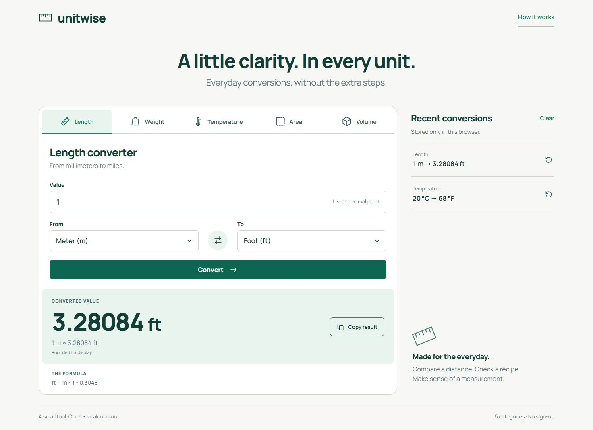
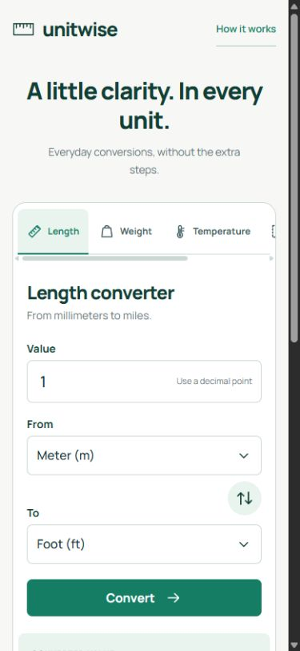
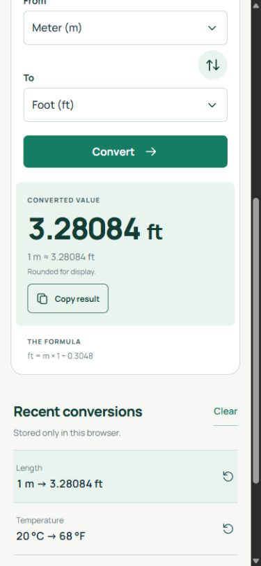
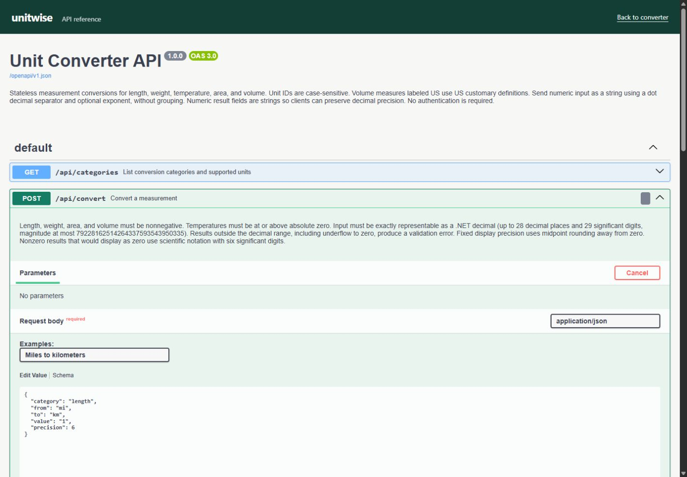
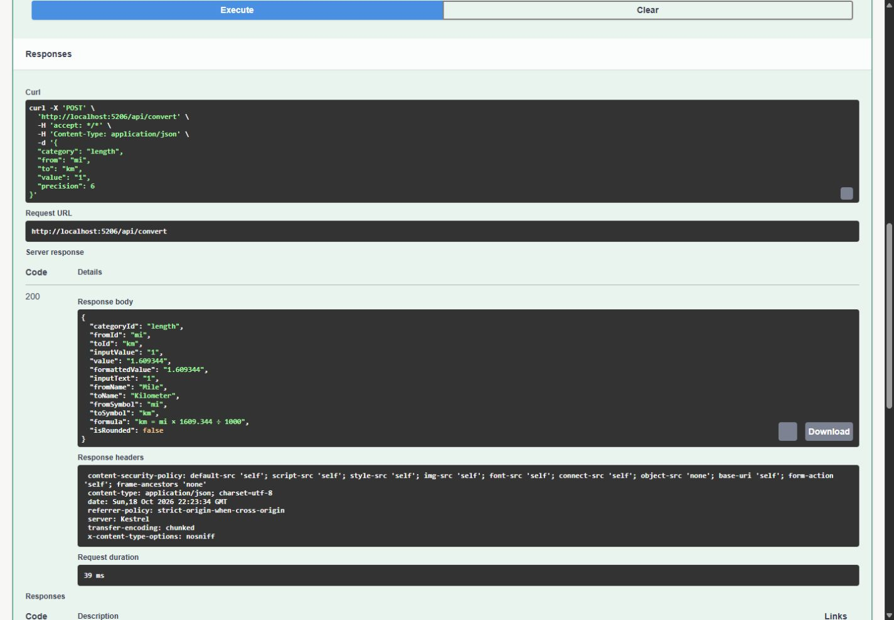

# Unitwise — Unit Converter

[](https://github.com/batuhansacofficial/UnitConverter/actions/workflows/ci.yml)
[](docs/verification.md)

A responsive ASP.NET Core application for converting **length, weight, temperature, area and volume**. One conversion engine powers both the web interface and a documented JSON API. No database, account or external conversion service is required.

**[Live demo](https://unitwise-batuhansac.onrender.com)** · **[Swagger UI](https://unitwise-batuhansac.onrender.com/swagger)** · **[Architecture](docs/architecture.md)** · **[Postman collection](docs/unitwise.postman_collection.json)** · **[CI and coverage](https://github.com/batuhansacofficial/UnitConverter/actions/workflows/ci.yml)**

The demo uses Render's free plan. After inactivity, the first load can take about a minute while the service wakes up. [Hosting details](https://render.com/docs/free#spinning-down-on-idle)

## What to try in 60 seconds

1. Convert `1 meter` to feet, then swap the units.
2. Select Temperature: `20 °C` becomes `68 °F`; a value below absolute zero produces a field error.
3. Copy a result or restore a recent conversion. The last five conversions stay in your browser and can be cleared.
4. Open `/swagger` to send a real request and inspect its response, or import the Postman collection.



<details>
<summary>Phone layout and Swagger screenshots</summary>







</details>

## Technical overview

| Component | Implementation |
| --- | --- |
| Backend | .NET 10, ASP.NET Core Razor Pages and Minimal APIs |
| Frontend | Semantic HTML, responsive CSS, self-hosted Manrope, progressive JavaScript |
| Conversion | Immutable unit catalog, exact rational intermediates, decimal results, explicit temperature offsets |
| Validation | Numeric syntax and range, unit/category boundaries, absolute zero, overflow and underflow |
| API | JSON success responses, ProblemDetails errors, OpenAPI 3.0 and self-hosted Swagger UI |
| Verification | xUnit domain and HTTP integration tests; Cobertura coverage; container smoke checks |
| Delivery | GitHub Actions, non-root Linux Docker image, free Render web service |

The interface uses labeled native controls, visible keyboard focus, announced result/error states and a mobile layout. The conversion form works without JavaScript; browser history and clipboard are optional enhancements. See [architecture and decisions](docs/architecture.md) for the request flow and numeric boundaries.

## Run locally

Install the [.NET 10 SDK](https://dotnet.microsoft.com/download/dotnet/10.0), then run from the repository root:

```sh
dotnet run --project UnitConverter --launch-profile http
```

Open **[http://localhost:5206](http://localhost:5206)**. Swagger UI is at **[http://localhost:5206/swagger](http://localhost:5206/swagger)**. There are no secrets, migrations or frontend package-install steps.

With Docker:

```sh
docker build -t unitwise .
docker run --rm -p 127.0.0.1:5206:8080 unitwise
```

## Tests and coverage

```sh
dotnet test --solution UnitConverter.slnx --configuration Release --results-directory TestResults -- --report-trx --report-trx-filename tests.trx --coverlet --coverlet-output-format cobertura --coverlet-include "[UnitConverter]*"
```

For a Linux container test run:

```sh
docker build --target test -t unitwise-tests .
```

CI restores and builds the solution, runs tests and coverage, builds the runtime image, and smoke-tests its HTTP endpoints and non-root user. Every run publishes TRX and Cobertura files in the **test-results** artifact and summarizes measured line/branch coverage. The CI badge above reflects GitHub's actual workflow status.

**Verified locally in Linux:** 85 tests passed, 0 failed, 0 skipped. Measured application line coverage: **95.5%**; branch coverage: **90%**; conversion-domain line coverage: **97.14%**. The coverage badge is this measured snapshot; each CI run publishes its own reports. JavaScript and CSS are outside this measurement. See [verification and environment limits](docs/verification.md). Automated checks do not establish complete accessibility conformance.

## API example

`POST /api/convert` with `Content-Type: application/json`:

```json
{
  "category": "temperature",
  "from": "c",
  "to": "f",
  "value": "20",
  "precision": 6
}
```

The response includes `value: "68"`, `formattedValue: "68"`, unit symbols, a formula and `isRounded: false`. Numeric inputs and outputs are strings to preserve decimal digits in clients. `GET /api/categories` lists all valid units. The contract is at `/openapi/v1.json`; `/health` returns application readiness. The Postman collection targets the live demo; change `baseUrl` to `http://localhost:5206` for local requests.

Input uses a decimal point and no grouping separators; scientific notation is accepted. Display defaults to six decimal places, or six significant digits for very small results. Recipe measures are explicitly **US** units; “Weight” represents mass. Conversion factors reference [NIST SP 811](https://www.nist.gov/pml/special-publication-811/nist-guide-si-appendix-b-conversion-factors/nist-guide-si-appendix-b9).

## Deployment

The live demo runs the non-root Docker image on a free Render service in Frankfurt. It was manually deployed after verification and a [passing GitHub CI run](https://github.com/batuhansacofficial/UnitConverter/actions/runs/39172582288). To release a code change, wait for CI to pass and use Render's **Manual Deploy → Deploy latest commit**. Automatic deployment is currently off. `render.yaml` is an optional Blueprint configuration for a service that deploys after CI checks pass.

See [verification](docs/verification.md) for the deployed source revision, hosted checks and environment boundaries.

Inspired by the [roadmap.sh Unit Converter project](https://roadmap.sh/projects/unit-converter).
