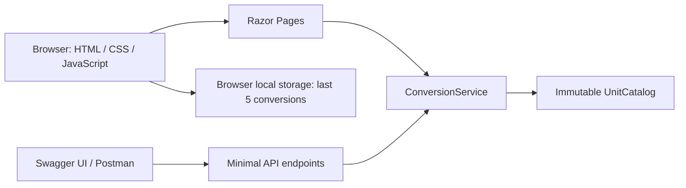

# Architecture

Unitwise is a small ASP.NET Core application with two entry points and one conversion engine. It uses Razor Pages for the interface and Minimal APIs for programmatic clients. Both call the same stateless service. No database or separate frontend build is required.



## Request flow

1. A category selects its units and defaults from the catalog.
2. A form POST includes an antiforgery token. The page model validates the request through `ConversionService` and renders the result or field errors.
3. JavaScript enhances that same form with a background request and replaces the rendered converter panel. It does no conversion arithmetic. Native form submission works when JavaScript is disabled.
4. The JSON API accepts a numeric string and returns a result or a field-specific ProblemDetails response. Swagger UI reads the versioned OpenAPI document.

## Numeric decisions

- Each length, mass, area or volume unit has an exact decimal factor to a base unit. Temperatures use explicit affine formulas and reject values below absolute zero.
- A small rational-number helper prevents intermediate decimal overflow and preserves exact factors until the final result. The public numeric range is the .NET `decimal` range. Results too small to represent produce a validation error.
- Display defaults to six decimal places, with midpoint rounding away from zero. Small nonzero values use scientific notation with six significant digits. An approximation indicator appears when display rounding changes the value.
- API numeric values are strings so JavaScript clients do not lose decimal digits. `formattedValue` is presentation text; `value` is the computed decimal value.
- All input uses a dot decimal separator, optional exponent, and no grouping separators, independent of server culture. Negative measurements are rejected except valid absolute temperatures.
- The UI's “Weight” category represents mass. Customary volume labels explicitly identify US measures; Imperial and US measures are not interchangeable. Factors refer to [NIST SP 811](https://www.nist.gov/pml/special-publication-811/nist-guide-si-appendix-b-conversion-factors/nist-guide-si-appendix-b9).

## Boundaries

| Area | Decision |
| --- | --- |
| UI | Semantic labels, native selects, visible focus, inline validation, announced results, reduced-motion support, responsive layout |
| History | Last five successful form conversions in local storage; clear and restore; session-only fallback if storage is unavailable |
| Security | Antiforgery on forms, JSON-only API requests, encoded output, same-origin content policy, no accounts or secrets |
| Deployment | One non-root Linux container; TLS terminates at the hosting platform; `/health` is a dependency-free readiness endpoint |
| Tests | Domain reference values, boundaries, round trips and presentation; HTTP integration checks for API contracts, validation, Razor form flow and request protection |
| CI | Restore, Release build, tests with Cobertura coverage, runtime image build and smoke test; reports uploaded as workflow artifacts |

## Repository map

```text
UnitConverter/
  Conversion/     unit catalog, conversion rules, validation and formatting
  Api/            JSON endpoint mapping and request/response contracts
  Pages/          page handlers, forms, layout and error page
  wwwroot/        self-hosted styles, scripts, font, Swagger UI and OpenAPI
UnitConverter.Tests/  domain and HTTP integration tests
.github/workflows/ci.yml
Dockerfile
render.yaml
docs/             screenshots, Postman collection and verification notes
```

The OpenAPI contract is maintained explicitly and checked by integration tests. A future endpoint/schema change must update both the contract and its tests. This application intentionally has no database, user authentication, financial/currency conversions, or external conversion API.
